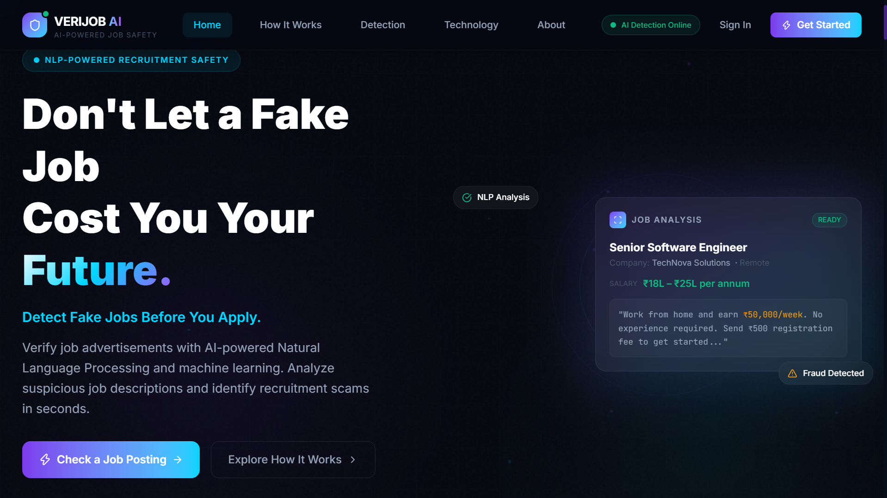
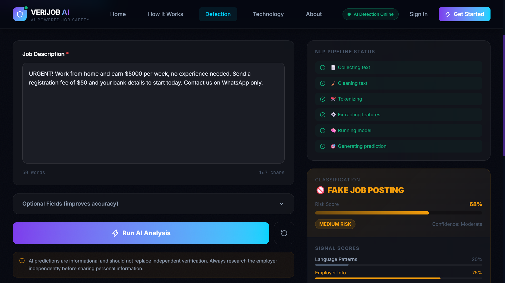

# VERIJOB AI

A fake job posting detector. Paste a job description and the app returns a risk score, a classification (likely real or likely fake), and the specific signals that drove the result, so users can see *why* a posting looks suspicious.

Built with a React front end and a FastAPI backend serving classical NLP models (TF-IDF + scikit-learn) trained on a public fake-job-posting dataset.

   

   

## How it works

1. **Paste a job posting** on the Detector page (title, company, location and salary are optional extras).
2. **The React app calls the API** (`POST /api/analyze`).
3. **The backend cleans the text** with the same preprocessing used at training time (tokenising, stop-word removal, lemmatising with NLTK), so inference matches training.
4. **TF-IDF features plus three structured signals** (`telecommuting`, `has_company_logo`, `has_questions`) go into the trained classifier.
5. **The response** includes the classification, risk level and score, confidence, human-readable reasons, matched keywords and the model used.

| Model | Precision (fake) | Recall (fake) | F1 (fake) | Fake caught | Fake missed | False alarms |
| --- | --- | --- | --- | --- | --- | --- |
| **Random Forest** (used) | 0.990 | 0.590 | 0.739 | 102 | 71 | 1 |
| Logistic Regression | 0.586 | 0.908 | 0.712 | 157 | 16 | 111 |
| Naive Bayes | 0.764 | 0.393 | 0.519 | 68 | 105 | 21 |

**Why Random Forest is the served model:** the training script selects the model with the best F1 score on the fake class, and Random Forest wins (0.739). It is very precise, with only one false alarm on the test set, but it misses about 41% of fake postings. Logistic Regression is the opposite trade-off: it catches about 91% of fake postings at the cost of many false alarms. To serve a different model, change the name in `ml/models/best_model.txt`.

## Tech stack

- **Front end:** React 19, Vite, Tailwind CSS 4, Framer Motion, React Router
- **Back end:** FastAPI, Uvicorn, Pydantic
- **ML / NLP:** scikit-learn, NLTK, pandas, SciPy, joblib

## Project structure

```
src/                 React app (pages, components, services/api.js)
ml/
  src/               preprocessing.py, prepare_dataset.py, train_models.py
  backend/           FastAPI app (main.py) and requirements.txt
  models/            trained models, TF-IDF vectorizer, model_comparison.csv
  data/              datasets (not committed, see below)
```

## Getting started

You need Node.js and Python 3.

### 1. Run the backend

```bash
cd ml/backend
python -m venv .venv
# Windows:        .venv\Scripts\activate
# macOS / Linux:  source .venv/bin/activate
pip install -r requirements.txt
uvicorn main:app --reload --port 8000
```

On first start NLTK downloads a few small language resources, so an internet connection is needed. Then open http://localhost:8000/docs for the interactive API docs, or http://localhost:8000/api/health to check it is running.

### 2. Run the front end

In a second terminal, from the project root:

```bash
npm install
npm run dev
```

Open the address Vite prints (usually http://localhost:5173) and go to **Detector**.

### 3. Configuration

Copy `.env.example` to `.env` if you want to point the app at a different API address:

```
VITE_API_BASE_URL=http://localhost:8000
```

## API

`POST /api/analyze`

```json
{
  "text": "Full job description...",
  "title": "optional",
  "company": "optional",
  "location": "optional",
  "salary": "optional"
}
```

The response contains `classification`, `risk_level`, `risk_score`, `confidence`, `reasons`, `features`, `stages`, `found_keywords`, `word_count`, `model_used`, `analyzed_at` and `disclaimer`.

## Retraining the models (optional)

The trained models are included, so you do not need the data to run the app. To retrain:

1. Download the public Kaggle *Real / Fake Job Posting Prediction* dataset (`fake_job_postings.csv`) and place it in `ml/data/`.
2. Run the pipeline:

```bash
cd ml/src
python prepare_dataset.py   # cleans the text, writes ml/data/processed_job_postings.csv
python train_models.py      # trains the three models and writes ml/models/
```

## Limitations

- Results are a **risk signal, not a guarantee**. The served model (Random Forest) favours precision, so it misses some fake postings (recall about 59%). A "looks fine" result is not proof that a job is real, so always verify the employer independently.
- The model learns from one public dataset (about 95% real and 5% fake postings), so it may not generalise to every region, industry or posting style.
- **Sign in / Sign up is demo-only.** There is no real authentication; the session is stored in the browser.
- The API allows requests from any origin (CORS `*`), which is fine for local use and should be restricted before any deployment.
- Saved models depend on the scikit-learn version they were trained with. This repo pins `scikit-learn==1.7.2` and was tested on Python 3.10. If loading fails after a version change, retrain with the steps in "Retraining the models".

## Author

Built by **Riya Patkar** ([@riyax11](https://github.com/riyax11)).
